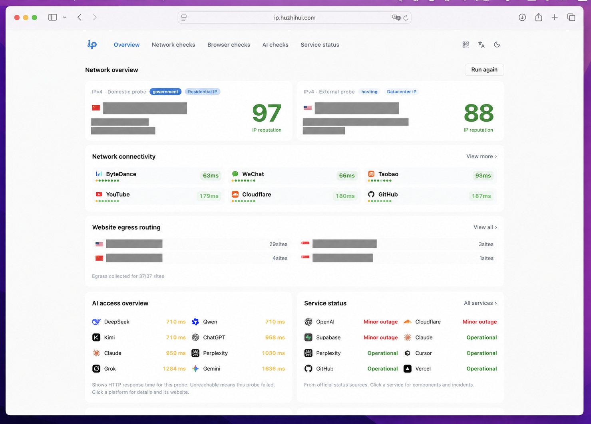
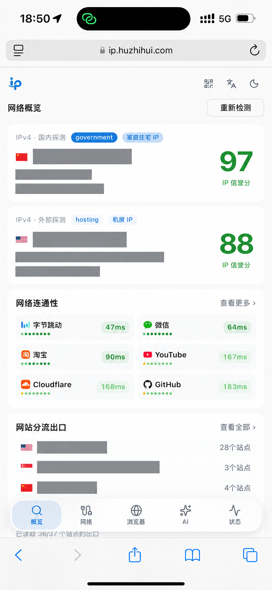
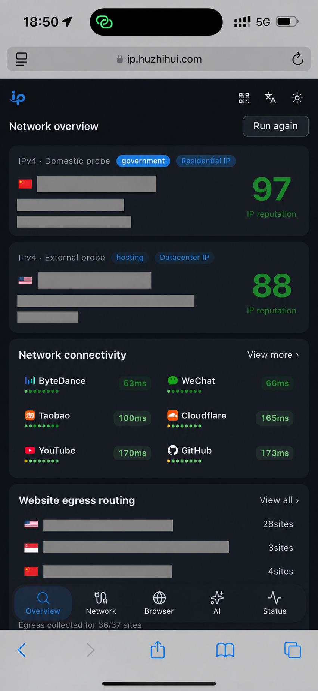

#  One IP

<p align="left">
  
  
  
  
</p>

IP 情報の検索、ネットワーク診断、ブラウザチェック、AI サービスの稼働状況確認をまとめたツールボックスです。

[中文](README.md) · [English](README.en.md) · **日本語**

[ライブデモ](https://ip.huzhihui.com/) · [GitHub](https://github.com/zhihui-hu/one-ip)



<table>
  <tr><th>モバイル · ライト</th><th>モバイル · ダーク</th></tr>
  <tr>
    <td></td>
    <td></td>
  </tr>
</table>

## 機能

- **現在の IP（ホーム）**：IPv4 / IPv6 の所在地、ISP、ASN、レピュテーションスコア、地図を表示します。IP のチェックは新しいタブで開きます
- **リークテスト**：DNS リークと WebRTC リークを検査します
- **ネットワーク解除チェック**：AI、動画配信、地域限定サイトへの到達性と経路上の出口を確認します。ChatGPT と Claude の診断も含みます
- **速度テスト**：Cloudflare のエッジネットワーク経由でダウンロード、アップロード、レイテンシを測定します
- **その他のツール**：WHOIS、グローバル Ping、ブラウザフィンガープリントと整合性のチェック、サービスステータス
- 中国語 / 英語、ライト / ダークテーマ、モバイルレイアウトに対応。ブラウザネイティブの [WebMCP](https://developer.chrome.com/docs/ai/webmcp/) ツールも利用できます

結果はサードパーティのサービスに依存しており、レート制限や CORS の影響を受ける場合があります。IP の分類とスコアは参考情報です。

## デプロイ

Cloudflare へワンクリックでデプロイできます。

[](https://deploy.workers.cloudflare.com/?url=https%3A%2F%2Fgithub.com%2Fzhihui-hu%2Fone-ip)

または、リポジトリをフォークして Cloudflare の **Workers & Pages** にインポートし、ビルドコマンドに `pnpm build`、デプロイコマンドに `pnpm deploy` を指定してください。主要な機能に API キーは不要です。

Docker でセルフホストする場合：

```bash
cp .env.docker.example .env.docker   # optional settings
docker compose up -d --build         # open http://your-server:8080
```

Cloudflare Pages、リバースプロキシ、Tianditu 地図、人間による認証、GitHub Actions、フォークの同期については、[デプロイと設定](docs/deploy.en.md)を参照してください。

## ローカル開発

```bash
pnpm install --frozen-lockfile
pnpm worker:dev   # http://127.0.0.1:8787
pnpm build && pnpm test && pnpm lint
```

## データソース

Net.Coffee、ip-api、Globalping、IANA / RDAP、各プラットフォーム公式のステータスフィード。ブラウザチェックには FingerprintJS と CreepJS を使用しています（[vendor/browser-diagnostics](vendor/browser-diagnostics/README.md) を参照）。Claude 環境の辞書は [FuckClaude](https://github.com/LinXiaoTao/FuckClaude) をベースにしています（`vendor/claude-environment/` を参照）。結果はトラブルシューティング用であり、いずれのプラットフォームの公式な判断でもありません。

Issue を歓迎します。スクリーンショットを共有する際は、IP、所在地、フィンガープリント識別子をマスクしてください。

## ビジネス協力

クローズドソースの商用版をご用意しています。商用ライセンス、プライベートデプロイ、カスタム開発と API アクセス、技術サポートを提供します。ご利用の用途と想定規模を添えて、[ip@huzhihui.com](mailto:ip@huzhihui.com) または WeChat までご連絡ください。

<details>
  <summary>WeChat で連絡する（QR コードを表示）</summary>

  
</details>

## Star History

<a href="https://www.star-history.com/?repos=zhihui-hu%2Fone-ip&amp;type=date">
  <picture>
    <source media="(prefers-color-scheme: dark)" srcset="https://api.star-history.com/svg?repos=zhihui-hu/one-ip&amp;type=Date&amp;theme=dark" />
    
  </picture>
</a>
